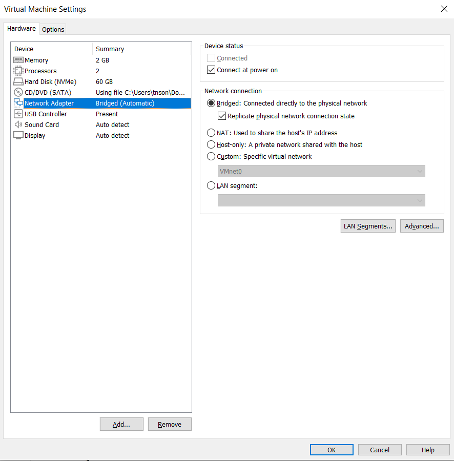

# Active Directory Lab (On-Premise, VMware Workstation Pro)

## Mục tiêu
Xây dựng hạ tầng Active Directory mô phỏng môi trường doanh nghiệp nhỏ,
thực hành quản trị AD DS, DNS, DHCP, GPO.
Quy mô công ty giả định

### Công ty: TechCorp Vietnam — 50 nhân sự, 6 phòng ban
| Phòng ban | Số lượng user | Viết tắt OU |
| --- | --- | --- |
| IT	| 5 | IT |
| HR (Nhân sự) | 5 | HR |
| Finance (Tài chính - Kế toán) | 8 | FIN |
| Sales (Kinh doanh) | 20 | SALES |
| Marketing | 7 | MKT |
| Management (Ban giám đốc) | 5 | MGMT |

### Quy ước đặt tên (Naming Convention) 
| Đối tượng | Format | Ví dụ |
| --- | --- | --- |
| Username	| `firstname.lastname` | `son.tran` |
| Email | `firstname.lastname@techcorp.local` | `son.tran@techcorp.local` |
| Máy tính | `TC-{DEPT}-{SỐ}` | `TC-SALES-001` |
| Security Group | `SG-{DEPT}-{Mục đích}` | `SG-SALES-FileAccess` |
| GPO | `GPO-{DEPT}-{Mục đích}` | `GPO-HR-USBBlock` |

### Security Group 
| Nhóm | Thành viên | Mục đích |
| --- | --- | --- |
| SG-IT-Admins	| 2 user IT | Toàn quyền quản trị domain |
| SG-IT-Helpdesk | 3 user IT | Chỉ reset password, không sửa GPO |
| SG-HR-FileAccess | 5 user HR | Truy cập share \DC01\HR |
| SG-FIN-FileAccess |  user Finance | Truy cập share \DC01\Finance |
| SG-SALES-FileAccess | 20 user Sales | Truy cập share \DC01\Sales |
| SG-MGMT-FullAccess | 5 user Management | Truy cập tất cả share (read-only) |
| SG-AllStaff-VPN | 50 user | Được phép kết nối WireGuard VPN |

### GPO cụ thể theo từng OU
| GPO | Áp cho OU | Nội dung cụ thể |
| --- | --- | --- |
| GPO-Domain-PasswordPolicy	| Toàn domain | Độ dài tối thiểu 10 ký tự, phức tạp bắt buộc, hết hạn 90 ngày, khóa 5 lần nhập sai trong 15 phút |
| GPO-Domain-ScreenLock | Toàn domain | Tự khóa màn hình sau 10 phút không thao tác |
| GPO-IT-RDPAllow | OU=IT | Cho phép Remote Desktop |
| GPO-HR-USBBlock | OU=HR, OU=Finance | Chặn USB storage (ngăn rò rỉ dữ liệu lương/tài chính) |
| GPO-Sales-MapDrive | OU=Sales | Tự động map ổ Z: vào \DC01\Sales khi đăng nhập |
| GPO-AllStaff-Wallpaper | Toàn domain | Đặt wallpaper + tên công ty, khóa không cho đổi |
| GPO-MGMT-NoControlPanel | OU=Management | Ẩn Control Panel/Settings (giảm rủi ro người dùng ít kỹ thuật tự sửa cấu hình) |

### Password Policy 
- Minimum password length: 10
- Password history: 2 
- Maximum password age: 90 ngày
- Account lockout threshold: 5 lần
- Account lockout duration: 15 phút

### Tự động hóa tạo user bằng PowerShell
Cấu trúc CSV mẫu (users.csv):

### File Server
| Share | Đường dẫn | Quota | Quyền truy cập |
| --- | --- | --- | --- |
| \DC01\HR	| D:\Shares\HR | 20GB | SG-HR-FileAccess (Modify) |
| \DC01\Finance	| D:\Shares\Finance | 30GB | SG-FIN-FileAccess (Modify) |
| \DC01\Sales	| D:\Shares\Sales |50GB | SG-SALES-FileAccess (Modify) |
| \DC01\Public	| D:\Shares\Public | 10GB | Toàn domain (Read) |

### Dải địa chỉ IP 
| Thành phần | Dải IP | Ghi chú |
| --- | --- | --- |
| Mạng Server	| 192.168.10.0/24 | DC01: 192.168.10.1 |
| Mạng Client	| 192.168.20.0/24 | DHCP scope 192.168.20.100-200 |
| DNS	| 192.168.10.1 | Trỏ về DC01 |
| Default Gateway	| 192.168.20.1 | 	(pfSense sau này) |

## Công nghệ sử dụng
- VMware Workstation Pro
- Windows Server 2022 (Domain Controller)
- Windows 11 (Client)

## Sơ đồ kiến trúc
```directory
techcorp.local
├── OU=Departments
│   ├── OU=IT
│   │   ├── OU=Users
│   │   └── OU=Computers
│   ├── OU=HR
│   ├── OU=Finance
│   ├── OU=Sales
│   ├── OU=Marketing
│   └── OU=Management
├── OU=Service Accounts
├── OU=Admin Accounts       (tách riêng tài khoản admin, không để chung OU user thường)
└── OU=Disabled Users        (user nghỉ việc, không xóa ngay — đúng thực tế doanh nghiệp)
```
## Tiến độ
- [x] Cài Windows Server, promote Domain Controller
- [x] Cấu hình DNS, DHCP
- [x] Tạo OU, user, security group
- [ ] Cấu hình GPO (password policy, map drive, chặn USB)
- [ ] Join client vào domain
- [ ] File Server + phân quyền NTFS/Share
- [ ] Backup và test restore

## Vấn đề gặp phải
<!-- Ghi lại mỗi khi gặp lỗi và cách xử lý -->
<p align="center">
  
</p>
</img>
## Hướng phát triển tiếp theo
- Đồng bộ lên Microsoft Entra ID (Entra Connect)
- Microsoft 365: user, license, MFA, Conditional Access
- Azure VM + NSG + RBAC
